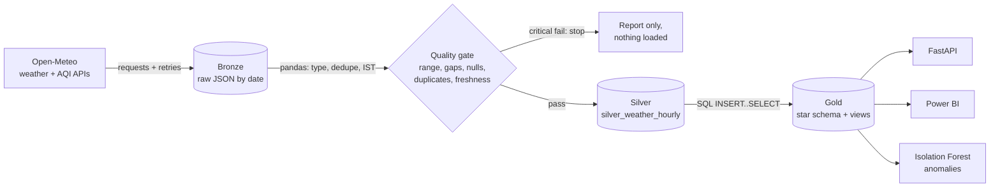
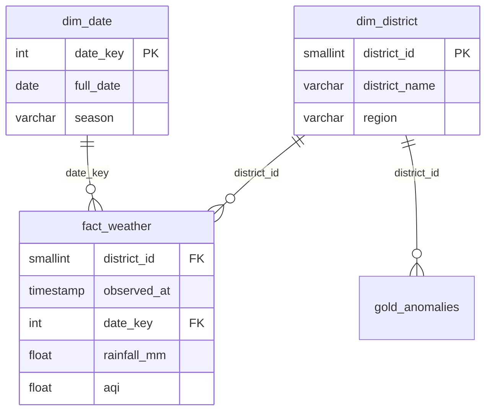

# Kerala Climate Pulse

An automated ELT pipeline that ingests hourly **weather and air-quality data for all 14 Kerala districts**
from [Open-Meteo](https://open-meteo.com) (free, no API key), cleans and validates it, models it as a
star schema in PostgreSQL, and serves it through a FastAPI service and a Power BI dashboard.



## Quick start

```bash
cp .env.example .env

# Option 1: everything in Docker (Postgres + API + one ingestion run)
docker compose up --build
open http://localhost:8000/docs

# Option 2: local Python (needs a Postgres, e.g. `docker compose up db -d`)
pip install -r requirements.txt
python verify_stage1.py                              # sanity check
python -m ingestion.run_pipeline --with-anomaly --export
uvicorn api.main:app --reload
```

Useful flags: `--skip-ingest` (reuse today's bronze files), `--run-date YYYY-MM-DD`, `--export` (CSVs for Power BI in `data/gold/`).
Hourly runs in Docker: `docker compose --profile scheduler up -d scheduler`.

## Layers

| Layer | Where | What happens |
|---|---|---|
| Bronze | `data/bronze/YYYY-MM-DD/<district>_<weather\|air_quality>.json` | Raw API responses plus fetch metadata. Retries with exponential backoff, atomic writes, re-runs overwrite the same files. |
| Silver | table `silver_weather_hourly` | Typed, de-duplicated on `(district_id, observed_at)`, IST timestamps, explicit units (°C, km/h, mm), `is_forecast` flag, upserted. |
| Gold | `dim_district`, `dim_date`, `fact_weather` + `vw_*` views | Star schema and SQL views using CTEs and window functions. |



Views: `vw_daily_district_summary`, `vw_rolling_rainfall` (3-day and 7-day windows, day-over-day change via `LAG`),
`vw_district_rankings` (`RANK()` for rain and AQI), `vw_latest_reading`, `vw_alerts`.

**Alert rules:** heavy rain = daily total of at least 64.5 mm (IMD "heavy" class; 115.6 mm very heavy, 204.5 mm extremely heavy).
Poor air = daily peak US AQI of at least 101 (151 and above is "unhealthy"). The thresholds live in `ingestion/constants.py`
and are mirrored in `sql/03_views.sql`.

## Data quality

`ingestion/quality_checks.py` runs **before** anything is written to silver and produces `reports/quality_report_latest.md`.

| Check | WARN | FAIL (stops the load) |
|---|---|---|
| Row count | | no rows |
| District coverage | | any of the 14 districts missing |
| Duplicate keys | | any duplicate `(district, hour)` |
| Missing hourly timestamps | any gap | more than 5% of expected hours |
| Nulls per column (observed hours) | over 5% | over 30% |
| Range validation (e.g. humidity 0-100) | any violation | over 5% of values |
| Freshness | latest hour over 6h old | over 24h old |

Out-of-range values that don't trip a FAIL are set to NULL before loading, so impossible readings never reach silver.
Every run is recorded in `pipeline_run_log` (status, rows loaded, quality verdict).

## API

| Endpoint | Description |
|---|---|
| `GET /health` | DB status and latest observation time |
| `GET /districts` | The 14 districts |
| `GET /district/{name}/latest` | Latest observed reading plus AQI category (accepts aliases like `trivandrum`, `cochin`, `calicut`) |
| `GET /district/{name}/history?days=7` | Daily summary with rolling rainfall (1-30 days) |
| `GET /alerts/heavy-rain?days=1` | Heavy-rain alerts in the last N days (1-7) |
| `GET /alerts/air-quality?days=1` | Poor-air-quality alerts |
| `GET /rankings/aqi`, `/rankings/rainfall` | Latest-day district rankings |
| `GET /anomalies?limit=50` | Most unusual hourly readings (Isolation Forest) |

Interactive docs at `/docs`.

## Scheduling and CI/CD

- `.github/workflows/ci.yml`: lint (ruff) and tests on every push, with a Postgres service for the integration test.
- `.github/workflows/ingest.yml`: runs the pipeline every 6 hours on a throw-away Postgres and uploads the quality report and gold CSVs as artifacts.
  GitHub runners can't reach your laptop's database, so for persistent history point `POSTGRES_*` at a hosted Postgres via repo secrets,
  or use the Docker `scheduler` profile on a machine that stays on.

## Tests

```bash
pytest                                  # 40 offline tests (SQLite + mocked HTTP)
RUN_PG_TESTS=1 pytest                   # adds the real-PostgreSQL integration test
```

Tests use synthetic payloads in Open-Meteo's response format (`tests/factories.py`), so they run without network access.
They cover retry behaviour, cleaning, every quality check, idempotent re-runs, the gold views, and every API endpoint.

## Power BI

See [`dashboard/POWERBI_GUIDE.md`](dashboard/POWERBI_GUIDE.md).

## Design decisions

- **Medallion layers:** raw data is kept untouched so any bug in cleaning can be fixed by replaying bronze.
- **Quality gate before load:** bad data is stopped at the door instead of cleaned up after the fact.
- **Upserts everywhere:** every step is safe to re-run; the 7-day backfill on each run self-heals missed runs.
- **Star schema:** one fact table keeps Power BI relationships simple and queries fast (composite PK plus a `(date_key, district_id)` index).
- **Portable SQL:** the DDL and views run on PostgreSQL and SQLite, which keeps unit tests fast.
- **`is_forecast` flag:** Open-Meteo returns the rest of today as a forecast; aggregates and "latest" use observed hours only.
- **Timestamps are tz-naive IST:** the API is asked for `Asia/Kolkata`; payloads in another offset are shifted to IST.

## Resume bullets

- Built an automated ELT pipeline ingesting hourly weather and air-quality data for 14 Kerala districts into PostgreSQL using a bronze/silver/gold architecture with idempotent upserts and retry-safe ingestion.
- Implemented a data quality gate (range, gap, duplicate, null, freshness and coverage checks) that blocks bad loads and writes a markdown report on every run.
- Modelled a star schema with SQL views (CTEs, window functions) for rolling rainfall, district rankings and heavy-rain/AQI alerts; served via a FastAPI API with 9 endpoints.
- Containerised with Docker Compose, automated tests and lint in GitHub Actions, scheduled ingestion, Isolation Forest anomaly detection, and a Power BI dashboard.
